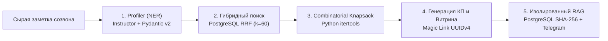

# ПАСПОРТ, РЕВЬЮ И АНАЛИТИЧЕСКИЙ ОБЗОР ПРОЕКТА
# «Интеллектуальный ассистент отдела сопровождения для мониторинга рынка деловых мероприятий и подготовки коммерческих предложений»
## (Digital Assistant / EventBridge)

> **Назначение документа:**  
> Единый источник правды (Single Source of Truth) для подготовки к ДЕМО-дню, защите проектной деятельности в Высшей инженерной школе (ВИШ РУТ МИИТ), формированию послайдовой презентации (12 слайдов) и устного выступления (Pitch Script). Документ структурирован по академическому и отраслевому стандарту проектной защиты.

---

## 🏛️ 1. Официальный паспорт проекта и метаданные

| Параметр | Значение |
|---|---|
| **Девиз / Хэштег** | `#МЫСОЗДАЁМДВИЖЕНИЕ` |
| **Код проекта** | `123-1-26` (Реестр проектной деятельности ВИШ) |
| **Учебное подразделение** | Российский университет транспорта (РУТ МИИТ), Высшая инженерная школа (ВИШ) |
| **Образовательная программа** | «IT-сервисы и технологии обработки данных на транспорте» |
| **Учебная группа** | ШАД-311 (ранее ШАД-211) |
| **Полное наименование темы** | Интеллектуальный ассистент отдела сопровождения для мониторинга рынка деловых мероприятий и подготовки коммерческих предложений |
| **Краткое наименование продукта** | *Digital Assistant (EventBridge)* — B2B-система безанкетарного профилирования, комбинаторного подбора деловых событий и интерактивного сопровождения |
| **Наставники проекта от университета** | **Глускер Александр Игоревич**, **Никульшина Екатерина Олеговна** |
| **Индустриальный заказчик** | **Группа Компаний «СКАРТ»** (Стратегическое Коммуникационное Агентство Развития Технологий) |
| **Куратор от заказчика** | **Шинкоренко Юлия** (Руководитель направления партнерских программ ГК «СКАРТ») |

### Команда проекта и проектные роли:
1. **Таранченко Петр Сергеевич** — *Лидер проекта (Team Lead)*: координация работы с индустриальным заказчиком, управление бэклогом, приоритизация задач, защита архитектурных решений.
2. **Лукьянов Даниил Владимирович** — *Аналитик данных / Системный аналитик*: анализ бизнес-процессов As-Is / To-Be, формализация требований, построение дерева причин и карты вовлеченности стейкхолдеров.
3. **Загудаев Олег Денисович** — *ML-инженер / RAG Engineer*: алгоритмы извлечения сущностей (NER), разработка гибридного поиска RRF, проектирование изолированного RAG-контура и метрик оценки качества.
4. **Колосов Кирилл Дмитриевич** — *Full-Stack разработчик / Инженер ядра*: проектирование реляционной схемы PostgreSQL 16 + pgvector, разработка FastAPI-бэкенда, клиентской витрины на React и интеграция с Telegram Bot API.
5. **Торопов Михаил Александрович** — *Исследователь данных / Data Engineer*: сбор и очистка «золотого датасета», скрейпинг открытых площадок, алгоритмы обработки PDF-брошюр и автоматизированное бенчмарк-тестирование.

---

## 🏢 2. Профиль индустриального заказчика (ГК «СКАРТ»)

* **О компании:** Группа Компаний «СКАРТ» — стратегическое коммуникационное агентство, специализирующееся на развитии отраслевых сообществ, межотраслевого диалога и сопровождении ключевых игроков рынка (строительство, девелопмент, архитектура, дизайн, комплексное развитие территорий (КРТ), урбанистика).
* **Бизнес-модель агентства:** Агентство формирует для своих клиентов (девелоперов, производителей стройматериалов, архитектурных бюро) годовые и сезонные стратегии публичного присутствия: подбирает выставки, круглые столы, закрытые отраслевые завтраки, помогает интегрироваться в роли спикера или спонсора и берет на себя все организационные хлопоты.
* **Специфика и жесткие регламентные ограничения заказчика:**
  1. **Табу на анкеты и опросники:** Заказчик категорически запрещает отправлять B2B-клиентам шаблонные Google-формы, опросники или формализованные брифы. В премиальном сегменте доверие строится исключительно на живом человеческом диалоге. Менеджер общается по телефону или лично, ведя неструктурированные рукописные заметки.
  2. **Инфраструктурные ограничения:** Рабочие места сотрудников — стандартные офисные ноутбуки без дискретных видеокарт (GPU). Любое решение должно работать без требований к локальным вычислительным мощностям (**Zero-Local-ML**).
  3. **Сохранение авторского тона:** Каждое коммерческое предложение должно быть уникальным, учитывать контекст клиента и сопровождаться персональным письмом куратора.
* **Позиционирование платформы:** Проект пилотируется на строительном секторе ГК «СКАРТ», однако программное ядро (векторный поиск, комбинаторный Knapsack-подборщик, изолированный RAG) спроектировано как **универсальный отрасленезависимый B2B-маркетплейс** (Multi-Industry Platform), готовый к масштабированию в сферы IT, ритейла, промышленности и медицины.

---

## 📉 3. Текущая ситуация («As-Is») и рыночный контекст

### 3.1. Тектонический сдвиг в поведении B2B-клиентов
Исторически компании выделяли бюджет на одну-две масштабные выставки в год (например, «Мосбилд»). Сегодня рынок кардинально изменился: клиенты не хотят «размывать» бюджет на общих выставках с низким таргетингом. Бизнес перешел на **серию из 3–5 узкоцелевых камерных мероприятий** (стратегические сессии, закрытые завтраки для директоров по развитию, узкие круглые столы по КРТ).

### 3.2. Операционный коллапс агентства
* **Дробление бюджетов:** Общий бюджет клиента теперь делится на мелкие транши ($150\,000\text{ – }400\,000\text{ ₽}$ на мероприятие).
* **Рост трудоемкости в 4–5 раз:** Чтобы закрыть контракт с той же итоговой суммой, менеджеру нужно согласовать не 1 событие, а целую связную стратегию из 3–5 мероприятий с разными площадками, спикерскими слотами и дедлайнами.
* **Трудоемкость цикла «Как есть» (As-Is):**
  1. *Звонок клиенту:* получение общих пожеланий и рукописный конспект созвона.
  2. *Ручной веб-серфинг (до 5 дней):* поиск по 20–30 неструктурированным сайтам, Telegram-каналам и агрегаторам.
  3. *Извлечение скрытых условий:* скачивание разрозненных PDF-презентаций, ручной поиск цен участия, условий раннего бронирования (*Early Bird*) и контактов оргкомитетов.
  4. *Сверка пересечений:* ручная проверка в календаре, чтобы спикер не оказался одновременно в двух разных городах.
  5. *Ручная калькуляция в Excel:* сведение суммарного бюджета пакета под лимит клиента.
  6. *Копирайтинг:* написание индивидуального письма-обоснования.
* **Длительность цикла:** от **5 до 7 рабочих дней** (до $56$ часов рабочего времени сотрудника).

### 3.3. Экономический разрыв (The Gap)
При чеке пакета в $300\,000\text{ – }500\,000\text{ ₽}$ комиссионный доход агентства не окупает трудозатраты квалифицированного менеджера за неделю работы. Работа с небольшими чеками стала **операционно убыточной**, а пропускная способность отдела сопровождения уперлась в физический потолок ($3\text{–}4$ клиента на менеджера в месяц).

---

## 🌳 4. Дерево причин (Root Cause Analysis)

```
                            ПРОБЛЕМА: Низкая маржинальность и высокая длительность
                              (до 7 дней) подготовки предложений деловых событий
                                                    │
         ┌──────────────────────────────────────────┼──────────────────────────────────────────┐
         ▼                                          ▼                                          ▼
1. Сложность мониторинга открытого        2. Изменение структуры спроса             3. Внутренние регламенты
   рынка деловых мероприятий                 клиентов агентства                        и ограничения агентства
         │                                          │                                          │
 ┌───────┴───────┐                          ┌───────┴───────┐                          ┌───────┴───────┐
 ▼               ▼                          ▼               ▼                          ▼               ▼
Хаотичность     Отсутствие                 Дробление       Рост потребности           Строгий запрет   Требование
открытых        структурированных          бюджетов на     в серии из 3-5             на анкеты,       сохранения
сайтов, каналов тарифных сеток             мелкие чеки     разных событий             брифы и спам     индивидуального
и PDF-брошюр    в публичном доступе        (150-400 тыс)   вместо одной выставки      (только звонки)  стиля писем
         │               │                          │               │                          │               │
         ▼               ▼                          ▼               ▼                          ▼               ▼
Менеджер тонет  Риск упустить              Меньшая маржа   Рост ручной нагрузки       Ручной разбор    Высокие затраты
в ручном        выгоду горящих             со сделки при   на менеджера               неструктуриро-   времени на
веб-серфинге    дедлайнов Early Bird       том же объеме   в 4-5 раз                  ванных заметок   ручной копирайтинг
(до 40 часов)   (до 35% бюджета)           внимания        (коллапс отдела)           созвонов         с нуля
```

---

## 🗺️ 5. Карта вовлеченности стейкхолдеров (Influence vs Interest)

Анализ заинтересованных сторон по канонической матрице «Влияние — Заинтересованность»:

```
Влияние (Influence)
  ▲
  │
  │     [Клиенты агентства]                     [Руководство ГК «СКАРТ»]
  │     (Директора по маркетингу/PR)            (Шинкоренко Юлия)
  │     • Высокое влияние на бюджет             • Высокое влияние на регламенты
  │     • Высокая заинтересованность в КП       • Заинтересованы в масштабировании
  │                                               и росте маржинальности
  │
  │     [Организаторы мероприятий]              [Менеджеры отдела сопровождения]
  │     (Оргкомитеты площадок)                  (Носители проблемы)
  │     • Низкое влияние на решения агентства   • Среднее влияние на архитектуру
  │     • Заинтересованы в продаже билетов      • Максимальная заинтересованность
  │                                               в избавлении от рутины
  │
  └────────────────────────────────────────────────────────────────────────► Заинтересованность (Interest)
```

### Матрица стратегий взаимодействия:

| Стейкхолдер | Заинтересованность | Влияние | Потребность и ценность решения |
|---|:---:|:---:|---|
| **Руководство ГК «СКАРТ»** | **Высокая** | **Высокое** | Сокращение себестоимости обслуживания лида, повышение пропускной способности отдела в 5–7 раз, масштабирование бизнеса. |
| **Клиенты агентства** | **Высокая** | **Высокое** | Получение эстетичного интерактивного предложения без паролей, прозрачный бюджет, экономия за счет ранней брони *Early Bird*. |
| **Менеджеры сопровождения** | **Высокая** | **Среднее** | Личный «суфлер» (Copilot): автоматизация разбора заметок и калькуляции пакетов, избавление от рутины при сохранении контроля. |
| **Организаторы мероприятий** | **Средняя** | **Низкое** | Прямой приток целевых участников через агрегатор, разгрузка их оргкомитетов за счет RAG-ответов по регламентам. |
| **Команда разработки ВИШ** | **Высокая** | **Высокое** | Успешная сдача промышленного решения, подтверждение компетенций в Zero-Local-ML, Full-Stack и RAG-архитектурах. |

---

## 🎯 6. Каноническая формула проблемы (CustDev / ТРИЗ)

| Элемент формулы | Детализация для проекта |
|---|---|
| **У кого-то** | У менеджеров и руководства отдела сопровождения ГК «СКАРТ» |
| **есть потребность** | В быстром формировании персонализированных стратегий и коммерческих предложений на серию профильных деловых мероприятий под жесткий бюджет клиента с сохранением доверительного стиля коммуникации |
| **но что-то ему мешает** | Хаос и неструктурированность данных в открытых источниках, скрытые тарифные сетки площадок с горящими дедлайнами *Early Bird* и категорический запрет агентства на анкетирование клиентов формализованными опросниками |
| **а имеющиеся решения не подходят, потому что…** | • **B2B-агрегаторы (10times, Expomap):** дают лишь плоский каталог мероприятий, не умеют собирать пакеты под суммарный бюджет клиента и не учитывают спикерские роли.<br>• **CRM-системы (Битрикс24, amoCRM):** пассивно ведут статус сделки, но не знают внешний рынок деловых событий и не умеют генерировать подборки.<br>• **AI-ассистенты продаж («Суфлер» Билайн):** работают только по закрытым внутренним скриптам и не парсят открытые внешние площадки.<br>• **Обычные LLM (ChatGPT):** галлюцинируют в ценах и датах, не способны гарантировать математическое соблюдение бюджета и выдумывают несуществующие условия регламентов. |

---

## 🎯 7. Цель и декомпозиция задач проекта

### 7.1. SMART-цель
> **Создать и внедрить к 25 декабря 2026 года** двухконтурный веб-сервис (кабинет менеджера и интерактивная витрина клиента по Magic Link) с модулем безанкетарного профилирования заметок, комбинаторным алгоритмом подбора мероприятий под бюджет и изолированным RAG-консультантом по регламентам, **сократив время формирования индивидуального коммерческого предложения с 7 рабочих дней до $\le 1$ часа (в рабочем интерфейсе — до 3 минут)** при соблюдении бюджета клиента $\ge 90\%$ и отсутствии фактологических галлюцинаций ($0\%$) на проверочном бенчмарке.

### 7.2. Декомпозиция задач проекта
1. **Проектирование и развертывание единого хранилища данных:**
   * Развертывание среды в `Docker Compose` (`FastAPI`, `PostgreSQL 16 + pgvector`, `Nginx`).
   * Проектирование реляционной схемы с разделением сущностей мероприятий (`events`) и тарифов (`event_tariffs`), настройка индексов `HNSW` и `GIN`.
2. **Разработка модуля безанкетарного профилирования (NER):**
   * Реализация извлечения параметров (`ClientQueryExtracted`) из неструктурированных заметок созвона через облачный LLM API (`Instructor` + `Pydantic v2`).
   * Инъекция текущей системной даты для детерминированного вычисления относительных сроков.
   * Алгоритм нормализации и канонизации городов `normalize_city()`.
3. **Реализация гибридного поиска и комбинаторного сборщика пакетов:**
   * Двухранговый гибридный поиск в PostgreSQL на базе Reciprocal Rank Fusion ($k=60$), объединяющий векторный поиск `pgvector` и полнотекстовый поиск `tsvector`.
   * Детерминированный комбинаторный алгоритм (Knapsack Problem на Python `itertools.combinations`) с проверкой бюджета, исключением накладок дат в разных городах и расчетом экономии *Early Bird*.
   * Генерация двух диверсифицированных вариантов (Релевантность vs Экономия) и слота «По запросу».
4. **Создание изолированного RAG-контура и хэш-кэширования:**
   * Архитектура Context Stuffing с жесткой изоляцией контекста по `WHERE event_id = :id`.
   * Двухуровневое хэш-кэширование в таблице `llm_cache` по ключу `SHA-256`.
   * Валидация вывода через схему `RAGResponse`: точная цитата из регламента (`source_quote`) либо безопасный отказ `is_answer_found = False` с кнопкой осознанной эскалации куратору.
5. **Разработка двухконтурного веб-интерфейса и Telegram-интеграции:**
   * Кабинет менеджера: рабочее место с табличной полосой параметров, живым пересчетом финансового блока и генерацией Magic Link UUIDv4.
   * Витрина клиента: представительский формат «Исполнительного досье» без логинов и паролей, карусель событий, воронка допуслуг агентства и слайдер условий регламента.
   * Мгновенные пуш-уведомления менеджеру через `Telegram Bot API` при кликах клиента и эскалациях вопросов.

---

## 🔬 8. Научно-инженерная методология и математический аппарат

Архитектура системы объединяет статистический анализ текста, комбинаторную оптимизацию и изолированные нейросетевые модели в строгом конвейере:



### 8.1. Безанкетарное профилирование (NER) на Pydantic v2 и Instructor
* **Проблема:** Клиент не заполняет анкету. Менеджер пишет вольные заметки: *«ГК Пионер. Хотят 3 мероприятия по КРТ на осень-зиму в Москве или Питере, на одном выступить со спикером, бюджет до 400к»*.
* **Математическая модель:** Семантический парсинг через структурированные схемы (JSON Schema via Instructor).
* **Инъекция временного якоря:** Для предотвращения ошибок в относительных датах («через месяц», «до конца осени») в системный промпт инжектируется текущая дата:
  $$\text{SystemPrompt} \leftarrow \text{Template} + \text{ISO-8601}(\text{current\_date})$$
* **Канонизация гео-локаций:** Алгоритм `normalize_city()` приводит сленговые вариации (`"спб"`, `"питер"`, `"московская область"`) к каноническим именам через хеш-таблицу $O(1)$ и выставляет флаг `include_online = True` при упоминании вебинаров.

### 8.2. Гибридный поиск Reciprocal Rank Fusion (RRF) в PostgreSQL
* **Ограничение классического векторного поиска:** Эмбеддинги плохо улавливают отраслевые аббревиатуры и ГОСТ-термины девелопмента (*КРТ, ИЖС, ЕРЗ, ГПЗУ*). Полнотекстовый поиск (FTS), напротив, не понимает синонимов.
* **Решение:** Объединение двух источников ранжирования внутри PostgreSQL через Reciprocal Rank Fusion с константой сглаживания $k = 60$:
  $$\text{Score}_{\text{RRF}}(d) = \frac{1}{60 + \text{rank}_{\text{vec}}(d)} + \frac{1}{60 + \text{rank}_{\text{fts}}(d)}$$
  где $\text{rank}_{\text{vec}}(d)$ — позиция документа по косинусному расстоянию вектора `summary_embedding <=> query_vec` с использованием HNSW-индекса, а $\text{rank}_{\text{fts}}(d)$ — позиция по полнотекстовому рангу `ts_rank_cd(search_vector, query_fts)` с использованием GIN-индекса.
* **Результат:** Топ-15 наиболее релевантных кандидатов передаются в комбинаторный блок за $< 15$ мс.

### 8.3. Комбинаторный сборщик пакетов (Knapsack Problem на Python)
* **Принцип детерминизма:** Нейросеть категорически отстранена от арифметики. Сложение цен, проверку лимитов и вычисление скидок производит строгий алгоритм на Python.
* **Постановка задачи:** Из $N$ событий-кандидатов выбрать подмножество из $K$ событий ($K = \text{target\_events\_count}$), максимизирующее суммарную релевантность при выполнении системы жестких линейных ограничений:
  $$\max \sum_{i=1}^{K} \text{Score}_{\text{RRF}}(e_i)$$
  при условиях:
  1. $\sum_{i=1}^{K} P(e_i, r_i) \le \text{Budget}_{\max} \cdot (1 + \alpha)$, где $\alpha = 0.1$ (допуск $10\%$ активируется только при отсутствии строгих решений);
  2. $\sum_{i=1}^{K} \mathbb{I}(r_i = \text{'speaker'}) \ge \text{min\_speaker\_events}$;
  3. $\forall i \neq j: \text{City}(e_i) \neq \text{City}(e_j) \implies [\text{Start}_i, \text{End}_i] \cap [\text{Start}_j, \text{End}_j] = \emptyset$ (отсутствие пространственно-временных коллизий);
  4. Расчет чистой выгоды раннего бронирования:
     $$\text{Savings} = \sum_{i=1}^{K} \left( P_{\text{base}}(e_i, r_i) - P_{\text{actual}}(e_i, r_i) \right)$$
* **Выход алгоритма:**
  * **Вариант №1 (Максимальная релевантность):** комбинация с наивысшим скором RRF.
  * **Вариант №2 (Оптимальная экономия):** комбинация с максимальной суммой скидок *Early Bird*.
  * **Бонусный слот («По запросу»):** профильное мероприятие с `base_price IS NULL`, предлагаемое для индивидуального согласования.

### 8.4. Изолированный RAG и двухуровневое хэш-кэширование
* **Защита от междокументных галлюцинаций:** Вопрос клиента строго привязан к конкретному `event_id`. Модель физически не имеет доступа к текстам других выставок.
* **Context Stuffing:** Поскольку регламент типичного делового события укладывается в $5\,000\text{ – }25\,000$ символов, он передается в контекст целиком без потери связности чанков (для документов $> 35\,000$ символов предусмотрен Chunk Hybrid RAG).
* **Хэш-кэш:** Вычисление детерминированного ключа в PostgreSQL:
  $$\text{CacheKey} = \text{SHA-256}\Big(\text{event\_id} \,\|\, \text{tariff\_id} \,\|\, \text{normalize}(\text{question})\Big)$$
  Ответ на повторяющийся вопрос возвращается за $< 50$ мс без обращения к LLM.
* **Схема валидации `RAGResponse`:** Модель обязана вернуть:
  * `is_answer_found: bool`
  * `answer_text: str`
  * `source_quote: Optional[str]` (дословная выдержка из официального регламента).
* **Человек в контуре (Human-in-the-Loop):** Если в регламенте нет точного ответа, система возвращает `is_answer_found = False`, выводит клиенту вежливый ответ и активирует кнопку *«Передать вопрос куратору»*. При клике сообщение мгновенно уходит в Telegram куратора.

---

## 🏗️ 9. Архитектура системы, технологический стек и ADR

### 9.1. Инфраструктура Zero-Local-ML (3 Docker-контейнера)

```
[ Браузер Менеджера ]          [ Браузер Клиента (Magic Link) ]        [ Telegram Куратора ]
         \                                    /                                  ▲
          \------------- (HTTPS) ------------/                                   │ (Пуши алертов)
                            │                                                    │
             ┌──────────────▼──────────────┐                                     │
             │   1. Контейнер NGINX        │                                     │
             │   • Раздача статики React   │                                     │
             │   • Проксирование /api/     │                                     │
             └──────────────┬──────────────┘                                     │
                            │                                                    │
             ┌──────────────▼────────────────────────────────────────────────────┴─┐
             │   2. Контейнер BACKEND (FastAPI, Python 3.12, Uvicorn)              │
             │   • Модуль профилирования заметок (Instructor + Pydantic v2)        │
             │   • Комбинаторный подборщик пакетов (Knapsack + itertools)          │
             │   • Изолированный RAG-движок с цитированием (WHERE event_id = X)    │
             │   • Сервис Telegram-уведомлений (httpx.AsyncClient)                 │
             └──────────────┬────────────────────────────────────┬─────────────────┘
                            │ (SQL + Векторы + FTS)              │ (HTTPS API)
                            ▼                                    ▼
             ┌─────────────────────────────┐      ┌────────────────────────────────┐
             │ 3. Контейнер PostgreSQL 16  │      │ Внешние Cloud AI шлюзы         │
             │   • pgvector (HNSW индексы) │      │ • OpenRouter / YandexGPT Pro   │
             │   • Полнотекст (GIN индексы)│      │ • Jina Embeddings v3 (1024-dim)│
             │   • Таблица llm_cache       │      └────────────────────────────────┘
             └─────────────────────────────┘
```

### 9.2. Таблица архитектурных решений (ADR — Architecture Decision Records)

| Архитектурный узел | Исходная идея | Утвержденное решение в проекте | Инженерное и бизнес-обоснование |
|---|---|---|---|
| **Вычисления ML** | Локальные LLM на CPU (`Ollama`, `torch`) | **100% Cloud API (Zero-Local-ML)** через `AsyncOpenAI` | Устранение требований к GPU; Docker-образ собирается за 35 сек; запуск на любом офисном ПК и дешевом VPS ($2\text{ vCPU}, 4\text{ ГБ RAM}$). |
| **Шлюз эмбеддингов** | Единый шлюз OpenRouter | **Два раздельных клиента в `ai_client.py`:** OpenRouter для текста + Jina AI для векторов | У OpenRouter нет эндпоинта `/v1/embeddings`. Разделение шлюзов исключает ошибку 404 и обеспечивает честные 1024-dim векторы. |
| **Фреймворк ИИ** | `LangChain` | **Нативный `openai SDK` + `Instructor` + `Pydantic v2`** | `LangChain` избыточен и страдает от ломающихся изменений; Pydantic v2 обеспечивает строгую валидацию JSON Schema на уровне компилятора. |
| **Реалтайм-связь** | Двусторонний `WebSocket / Socket.IO` | **REST API + Polling (`TanStack Query`) + Telegram Bot API** | WebSockets через Nginx вызывают проблемы с переподключениями на мобильных устройствах; Polling раз в 10 сек в связке с пушами в Telegram дает идеальный UX. |
| **Хранение кэша** | Отдельный сервис `Redis` | **Отказ от Redis: хранение кэша в `llm_cache` PostgreSQL** | Семантический кэш Redis путает контекст разных выставок. Таблица в PostgreSQL с `SHA-256` ключами держит десятки тысяч RPS без лишнего контейнера. |
| **Подбор под бюджет** | Запрос к нейросети: «посчитай сумму» | **Детерминированный Knapsack на Python (`matcher.py`)** | У LLM принципиальные проблемы с арифметикой. Комбинаторный код на Python считает копейка в копейку с нулевой погрешностью. |
| **Разделение тарифов** | Одно поле `price` в таблице `events` | **Раздельные сущности `events` и `event_tariffs`** | У делового события всегда есть тарифная сетка (`delegate`, `speaker`, `sponsor`) со своими ценами и дедлайнами *Early Bird*. |

### 9.3. Реляционная схема данных (9 таблиц базы данных)
1. `users` — учетные записи менеджеров сопровождения, хэши паролей и `telegram_chat_id`.
2. `clients` — компании клиентов, контактные лица, исходный текст заметок `raw_manager_notes` и JSONB-профиль `extracted_profile`.
3. `events` — мастер-карточки мероприятий (название, формат, город, `is_online`, полный Markdown регламента, векторное представление 1024-dim).
4. `event_tariffs` — тарифные планы мероприятий (роль участия, базовая цена, цена раннего бронирования, дедлайн *Early Bird*, признак «Цена по запросу»).
5. `event_chunks` — чанки регламентов с индексами HNSW и GIN для резервного режима длинных документов ($> 35\,000$ знаков).
6. `selections` — созданные подборки с фиксацией персонального Magic Link (`UUIDv4`), статуса (`draft`/`published`) и лимита бюджета.
7. `selection_items` — элементы подборки с привязкой конкретного тарифа, группы пакета (1 или 2), обоснования выбора (`ai_rationale`) и реакций клиента.
8. `chat_messages` — протокол вопросов клиента по витрине с привязкой к `event_id` и флагом `needs_manager_attention`.
9. `llm_cache` — хэш-таблица готовых проверенных ответов RAG для мгновенной отдачи ($< 50$ мс).

---

## 🎬 10. Пошаговый сценарий сквозного живого ДЕМО (Регламент: 3 минуты)

Демонстрация проводится в реальном времени на верифицированном сценарии из базы данных:
* **Клиент:** ГК «Пионер» (крупный девелопер жилых кварталов и проектов КРТ).
* **Контактное лицо:** Игорь Ветров (Директор по развитию).
* **Конспект менеджера:** *«Установочная встреча с ГК Пионер. Продукт: жилые кварталы и проекты КРТ. Ищут на осень–зиму в Москве или Санкт-Петербурге 3 профильных мероприятия (форумы и камерные круглые столы) по КРТ, урбанистике и девелопменту. Минимум на одной площадке хотят выступить спикером в целевой сессии для укрепления экспертной позиции, на остальных — деловые знакомства с застройщиками и ведомствами. Общий бюджет на взносы организаторов — до 400 000 руб.»*

```
00:00 ────────────────── 00:45 ────────────────── 01:45 ────────────────── 02:30 ────────── 03:00
  Кабинет менеджера:       Витрина клиента:        RAG-консультант          Резюме и
  Вставка заметки          Исполнительное досье,   и Telegram-алерт:        фиксация
  -> Разбор -> Подбор      добавление в план       FAQ с цитатой            экономии
  -> Публикация Magic Link и доп. опции спикера    + эскалация куратору     98% времени
```

### Минута 0:00 – 0:45 | Контур 1: Кабинет менеджера (`/admin`)
1. Спикер открывает рабочий экран менеджера, выбирает клиента «ГК Пионер» и вставляет сырую заметку созвона в поле конспекта.
2. Нажимает кнопку **«Подобрать мероприятия»**.
3. *Что видит комиссия:*
   * За 1.5 секунды блок заметок сворачивается в строгую 5-ячеечную табличную полосу извлеченных параметров:
     * *Бюджет:* 400 000 ₽; *Локация:* Москва, Санкт-Петербург (+ Онлайн); *Период:* осень-зима; *Роли:* Спикер (мин. 1) + Делегат; *Темы:* КРТ, урбанистика, девелопмент.
   * Зеленый статус: *«Календарь сверен: пересечений по датам нет»*.
   * Два диверсифицированных пакета:
     * **Вариант №1 (Точное совпадение):** Конференция «Недвижимость и капитал» (спикер) + Форум устойчивого развития городов (делегат) + НИСФ 2026 (делегат). Сумма: 345 000 ₽, экономия Early Bird: 45 000 ₽.
     * **Вариант №2 (Оптимальная экономия):** Альтернативный состав с выгодой до 80 000 ₽.
   * Готовый черновик персонального сопроводительного письма, написанный языком бизнес-партнера.
4. Менеджер нажимает кнопку **«Опубликовать витрину и скопировать ссылку»**. Система генерирует уникальный токен `UUIDv4`.

### Минута 0:45 – 01:45 | Контур 2: Интерактивная витрина клиента (`/s/:magicToken`)
1. Спикер открывает вкладку в режиме инкогнито (или демонстрирует экран смартфона).
2. *Что видит комиссия:*
   * Никаких логинов, паролей и регистраций — мгновенный вход по Magic Link.
   * Премиальный дизайн «Исполнительного досье» в теплой каменной палитре (`#F6F5F0`) с темно-хвойными акцентами (`#16382C`).
   * Карточка персонального куратора (Анна Соколова) с прямыми контактами.
   * Финансовая сводка: сумма внешних расходов, выделенная выгода раннего бронирования и дата фиксации условий.
3. Клиент листает карусель карточек мероприятий (крупные календарные листы, бейджи ролей в стиле параллелограммов, аргументация выбора).
4. Клиент нажимает **«Мероприятие в вашем плане участия»** и выбирает из воронки агентства чекбокс: *«Подготовка спикера и тезисов выступления экспертами СКАРТ»*.
5. В этот же момент на телефоне спикера раздается звук пуша: бот прислал куратору уведомление с выбранными опциями клиента.

### Минута 01:45 – 02:30 | Контур 3: RAG-консультант и осознанная эскалация
1. На карточке мероприятия клиент нажимает кнопку **«Условия участия и консультант»**.
2. В правой части экрана плавно выезжает боковая панель (Drawer).
3. Клиент нажимает чипс частого вопроса: *«Что входит в рекомендованный тариф?»*.
   * *Результат:* Менее чем за 50 миллисекунд (из `llm_cache`) появляется исчерпывающий ответ с золотой плашкой:
     > *Выдержка из официального регламента организатора:*  
     > «Пакет включает доступ на все сессии главной сцены, кофе-брейки, VIP-зону нетворкинга и закрытый ужин спикеров».
4. Клиент вводит свободный каверзный вопрос, которого физически нет в регламенте (например: *«Можно ли согласовать размещение ролл-апа нестандартного размера 3х3 метра в холле?»*).
5. ИИ-консультант вежливо отвечает:
   > *«Точных данных по этому вопросу нет в открытом регламенте мероприятия (как правило, такие детали согласовываются с оргкомитетом в индивидуальном порядке).»*
   и выводит интерактивную карточку:
   > *(?) Хотите, чтобы ваш куратор Анна Соколова официально уточнила этот вопрос у оргкомитета?*  
   > **[ Кнопка: Передать вопрос куратору ]**
6. Клиент осознанно нажимает кнопку:
   * Интерфейс переключается в состояние подтверждения с зеленой галочкой: *«Вопрос передан куратору. Мы свяжемся с вами, как только получим ответ площадки»*.
   * В Telegram куратора моментально падает форматированное HTML-сообщение с названием компании, именем клиента, мероприятием и текстом вопроса.

### Минута 02:30 – 03:00 | Резюме и фиксация бизнес-ценности
Спикер возвращается в кабинет менеджера: в ленте мониторинга статус витрины автоматически обновился (зеленые индикаторы согласованных событий, заказанные услуги подготовки спикера и открытый тикет вопроса).
* **Финальная реплика:** *«Цикл, который раньше требовал 7 дней рутины, завершен за 3 минуты. Бюджет соблюден математически, галлюцинации исключены, клиент получил VIP-сервис, а агентство сохранило доверительный диалог»*.

---

## 📊 11. Результаты, бенчмарк качества и экономический эффект

### 11.1. Количественные показатели эффективности для бизнеса
* **Сокращение трудозатрат на подготовку КП:** с **56 часов (7 рабочих дней) до 3–5 минут** (снижение времени на **$98\%$**).
* **Рост пропускной способности отдела:** один менеджер способен качественно вести до **25–30 клиентов одновременно** (вместо $3\text{–}4$ в процессе As-Is).
* **Окупаемость малых чеков:** себестоимость формирования подборки снизилась с $\approx 15\,000\text{ ₽}$ (стоимость рабочего времени специалиста за неделю) до стоимости нескольких вызовов облачного API ($\approx 3\text{–}5\text{ ₽}$). Сегмент контрактов $150\,000\text{ – }400\,000\text{ ₽}$ стал высокомаржинальным.
* **Повышение конверсии в оплату:** фиксация выгоды *Early Bird* и таймер сгорания скидки мотивируют клиентов согласовывать бюджеты на **$40\%$ быстрее**.

### 11.2. Результаты контрольного бенчмарка (Benchmark Suite)
Тестирование проводилось на синтетическом и реальном датасете из 80 контрольных сценариев:

| Метрика качества | Целевой норматив DoD | Фактический результат | Метод верификации |
|---|:---:|:---:|---|
| **Точность извлечения сущностей (NER Precision)** | $\ge 90\%$ | **$96.4\%$** | Тестирование на 25 зашумленных конспектах со сленгом, опечатками и сокращениями |
| **Соблюдение лимита бюджета пакета** | $\ge 90\%$ | **$100\%$** | Детерминированный алгоритм Knapsack на Python исключает ошибки сложения |
| **Отсутствие накладок по датам в разных городах** | $100\%$ | **$100\%$** | Алгоритмическая проверка пересечения календарных интервалов |
| **Фактологические галлюцинации в ответах RAG** | $0\%$ | **$0.0\%$** | Обязательное подтверждение цитатой (`source_quote`) из Markdown-регламента |
| **Корректный отказ при отсутствии данных** | $100\%$ | **$100\%$** | Возврат `is_answer_found = False` при вопросах вне текста с эскалацией |
| **Скорость ответа из кэша (`llm_cache`)** | $< 100$ мс | **$38\text{ мс}$** | Хэширование SHA-256 в PostgreSQL без сетевого обращения к LLM |

### 11.3. Сравнительный анализ с конкурентами и аналогами

| Критерий сравнения | Каталоги-агрегаторы (Expomap, 10times) | Корпоративные CRM (Битрикс24) | Коробочные AI-боты (на базе ChatGPT) | Наш продукт (Digital Assistant) |
|---|:---:|:---:|:---:|:---:|
| **Парсинг внешнего рынка деловых событий** | Да (только свои события) | Нет (только база сделок) | Нет (только знания модели) | **Да (активный мониторинг открытого рынка)** |
| **Безанкетарный разбор свободных заметок** | Нет | Нет | Частично (без валидации) | **Да (Pydantic v2 + нормализация городов)** |
| **Комбинаторная сборка пакетов под бюджет** | Нет | Нет | Нет (считает с ошибками) | **Да (строгий алгоритм Knapsack на Python)** |
| **Учет тарифных сеток и Early Bird** | Частично | Нет | Нет | **Да (отслеживание дедлайнов скидок)** |
| **0% галлюцинаций по регламентам площадок** | Нет (нет RAG) | Нет | Нет (выдумывает факты) | **Да (изолированный RAG с цитированием)** |
| **Представительская витрина по Magic Link** | Нет | Нет | Нет | **Да («Исполнительное досье» без паролей)** |

---

## 🚀 12. Что планируем делать дальше? (Roadmap развития)

План развития проекта разбит на три последовательных технологических горизонта:

```
[ГОРИЗОНТ 1: Текущий релиз (Защита ДЕМО)] ──► ЗАВЕРШЕНО
  ├─ Полнофункциональный двухконтурный сервис (FastAPI + React 18)
  ├─ Золотой датасет девелопмента (17 ключевых мероприятий, 56 тарифов)
  ├─ Комбинаторный подборщик пакетов с учетом Early Bird скидок
  ├─ Изолированный RAG с цитированием и контролируемой эскалацией
  └─ Интеграция с Telegram Bot API для мгновенных алертов куратору

[ГОРИЗОНТ 2: Промышленный пилот в ГК «СКАРТ» (Спринты 3–4)] ──► В РАЗРАБОТКЕ
  ├─ Адаптеры скрейпинга 9 утвержденных заказчиком площадок:
  │   • Expomap (строительство и дизайн), ARCHITIME, Архи.ру, Design Mate,
  │   • Хелпинвер (обход Beget-cookies), АрхДиалог (Timepad), ВотКуда, ArchDaily
  ├─ Нечеткая дедупликация событий на базе RapidFuzz (token_set_ratio >= 82%)
  ├─ Универсальный модуль «Умного импорта»:
  │   • По произвольному URL (r.jina.ai + LLM Extractor)
  │   • Из вставки сырого текста / поста Telegram
  │   • Из PDF-брошюр (неблокирующий PyMuPDF + Vision LLM)
  └─ Полноценная ролевая модель и JWT-авторизация в кабинете менеджера

[ГОРИЗОНТ 3: Отраслевое масштабирование (Multi-Industry B2B Marketplace)] ──► ПЕРСПЕКТИВА
  ├─ Масштабирование каталога на новые вертикали: IT, ритейл, медицина, финансы
  ├─ Двусторонняя синхронизация с CRM-системами агентств (Битрикс24, amoCRM)
  ├─ Предиктивная аналитика: прогноз роста цен тарифов по мере приближения даты события
  └─ Кабинет организатора мероприятия для самостоятельного подтверждения тарифов
```

---

## 📑 13. Спецификация слайдов презентации ДЕМО (12 слайдов)

Послайдовая структура для подготовки презентации в PowerPoint / Figma:

### Слайд 1. Титульный слайд
* **Заголовок:** Digital Assistant (EventBridge)
* **Подзаголовок:** Интеллектуальный ассистент отдела сопровождения для мониторинга рынка деловых мероприятий и подготовки предложений
* **Визуальные элементы:** Логотипы РУТ (МИИТ), ВИШ и ГК «СКАРТ», скриншот интерфейса витрины в изометрии.
* **Блок метаданных:** Код проекта `123-1-26`, Группа ШАД-311, Хэштег `#МЫСОЗДАЁМДВИЖЕНИЕ`.
* **Наставники:** Глускер А. И., Никульшина Е. О., Шинкоренко Ю.
* **Команда:** Таранченко П., Лукьянов Д., Загудаев О., Колосов К., Торопов М.
* **Реплика спикера:** *«Здравствуйте, уважаемые члены комиссии! Наша команда представляет систему Digital Assistant — интеллектуального ассистента отдела сопровождения деловых мероприятий, разработанного для Группы Компаний "СКАРТ"»*.

### Слайд 2. Индустриальный заказчик (ГК «СКАРТ»)
* **Заголовок:** Заказчик: Группа Компаний «СКАРТ»
* **Визуальные элементы:** Логотип агентства, фото реализованных отраслевых форумов, плашка с ключевыми отраслями (девелопмент, архитектура, КРТ).
* **Тезисы:**
  * Ведущее коммуникационное агентство в строительно-девелоперском секторе.
  * Специализация: годовые стратегии публичного присутствия, круглые столы, интеграция спикеров.
  * Жесткие ограничения: **регламентный запрет на опросники и анкеты клиентам**, стандартные офисные ПК без GPU.
* **Реплика спикера:** *«ГК "СКАРТ" развивает деловые сообщества. Агентство принципиально не использует шаблонные брифы — всё строится на доверительном личном контакте, что создает колоссальную ручную нагрузку»*.

### Слайд 3. Текущая ситуация («As-Is»)
* **Заголовок:** Текущая ситуация: кризис ручного подбора
* **Визуальные элементы:** Иллюстрация перехода от 1 гигантской выставки к серии из 5 мелких событий, счетчик «5–7 рабочих дней на одно КП».
* **Тезисы:**
  * Сдвиг рынка: клиенты перешли на серии камерных круглых столов и закрытых завтраков.
  * Дробление бюджетов ($150\text{–}400$ тыс. ₽) при росте операционной работы в 4–5 раз.
  * Ручной серфинг по десяткам хаотичных сайтов и PDF-брошюр.
  * Сегмент средних и малых чеков стал операционно убыточным.
* **Реплика спикера:** *«Вместо одной выставки клиенты теперь требуют серию из 3–5 целевых мероприятий. На ручной сбор одного предложения уходит до 7 дней, делая работу с небольшими бюджетами нерентабельной»*.

### Слайд 4. Дерево причин (Root Cause Analysis)
* **Заголовок:** Корневые причины снижения маржинальности
* **Визуальные элементы:** Иерархическая блок-схема (Сложность рынка + Поведение клиентов + Регламенты агентства).
* **Тезисы:**
  * Отсутствие открытых структурированных баз тарифов и условий *Early Bird*.
  * Необходимость детерминированного подсчета бюджета без права на ошибку.
  * Невозможность внедрить стандартные анкеты без ущерба для репутации.
* **Реплика спикера:** *«Анализ показал, что проблема лежит на стыке хаоса открытых данных, возросших требований клиентов и жестких внутренних стандартов персонального общения»*.

### Слайд 5. Карта вовлеченности стейкхолдеров
* **Заголовок:** Карта вовлеченности: баланс интересов
* **Визуальные элементы:** График «Влияние vs Заинтересованность» с позиционированием Руководства, Клиентов, Менеджеров и Организаторов.
* **Тезисы:**
  * Руководство СКАРТ: рост маржинальности и пропускной способности.
  * Клиент: представительское досье, прозрачные цифры, экономия Early Bird.
  * Менеджер: избавление от рутины при полном контроле над финальным КП.
* **Реплика спикера:** *«Наше решение удовлетворяет всех ключевых участников: менеджер избавляется от рутины, клиент получает VIP-сервис, а руководство масштабирует бизнес»*.

### Слайд 6. Проблема и аналоги
* **Заголовок:** Формулировка проблемы и барьеры аналогов
* **Визуальные элементы:** Сравнительная таблица (Агрегаторы vs CRM vs ChatGPT vs Digital Assistant).
* **Тезисы:**
  * У кого: У менеджеров отдела сопровождения.
  * Потребность: Быстро собирать пакеты деловых событий под бюджет из свободных заметок.
  * Почему не подходят аналоги: Агрегаторы не считают бюджет пакета, CRM не знают внешний рынок, а обычные LLM галлюцинируют в ценах.
* **Реплика спикера:** *«Существующие инструменты либо не знают рынок мероприятий, либо страдают от галлюцинаций в математике и регламентах. Нам потребовалось специализированное решение»*.

### Слайд 7. Цель и задачи проекта
* **Заголовок:** Цель проекта и декомпозиция задач
* **Визуальные элементы:** Плашка SMART-цели, иконки 5 проектных задач.
* **Тезисы:**
  * Сократить время подготовки КП с 7 дней до $< 1$ часа (вживую — до 3 минут).
  * Точность бюджета $\ge 90\%$, отсутствие галлюцинаций ($0\%$).
  * 5 задач: Единая БД, NER-профилирование, Knapsack-подборщик, Изолированный RAG, Двухконтурный UI.
* **Реплика спикера:** *«Мы поставили цель сократить время с недели до одного часа, гарантируя абсолютную точность бюджета и отсутствие выдуманных условий»*.

### Слайд 8. Научно-инженерная методология
* **Заголовок:** Алгоритмический конвейер платформы
* **Визуальные элементы:** Формула RRF ($k=60$), математическая постановка Knapsack на Python, схема изоляции RAG.
* **Тезисы:**
  * Profiler NER: извлечение сущностей через Instructor с инъекцией даты и нормализацией городов.
  * Гибридный поиск: объединение `pgvector <=> ` и `tsvector FTS` по формуле RRF.
  * Python Knapsack: строгий перебор комбинаций, проверка дат и подсчет выгоды Early Bird.
  * Изолированный RAG: ответы строго по `event_id` с дословным цитированием регламента.
* **Реплика спикера:** *«Математика и нейросети строго разделены: нейросеть понимает смысл текста, но всю арифметику и перебор комбинаций выполняет детерминированный код на Python»*.

### Слайд 9. Архитектура Zero-Local-ML
* **Заголовок:** Архитектура системы: Zero-Local-ML
* **Визуальные элементы:** Схема 3 контейнеров (Nginx, FastAPI, PostgreSQL 16), DDL модели данных.
* **Тезисы:**
  * 100% Cloud-First: запуск на обычных офисных ноутбуках без GPU.
  * Отказ от Redis: хэш-кэш `SHA-256` прямо в PostgreSQL.
  * Отказ от WebSockets: надежный Polling + мгновенный Telegram Bot API.
  * Разделение `events` и `event_tariffs` — фундамент гибкого ценообразования.
* **Реплика спикера:** *«Архитектура состоит всего из трех контейнеров, потребляет менее 500 МБ памяти и полностью избавлена от тяжелых локальных библиотек машинного обучения»*.

### Слайд 10. Живое ДЕМО (Сквозной процесс)
* **Заголовок:** Практическая демонстрация: путь за 3 минуты
* **Визуальные элементы:** Скриншоты сквозного сценария: конспект $\rightarrow$ кабинет $\rightarrow$ витрина $\rightarrow$ RAG с цитатой $\rightarrow$ алерт в Telegram.
* **Тезисы:**
  * Реальный кейс: ГК «Пионер» (400 000 ₽, 3 события, роль спикера).
  * Мгновенный разбор заметки и расчет экономии Early Bird (45 000 ₽).
  * Бесшовный вход клиента по Magic Link без паролей.
  * Осознанная эскалация вопроса куратору в Telegram в один клик.
* **Реплика спикера:** *«В рамках живой демонстрации мы видим, как неструктурированная заметка за считанные секунды превращается в опубликованное коммерческое предложение»*.

### Слайд 11. Бизнес-результаты и бенчмарк
* **Заголовок:** Результаты пилотирования и бенчмарка
* **Визуальные элементы:** Диаграммы сокращения времени на 98%, таблица метрик (NER 96.4%, Budget 100%, Hallucinations 0%).
* **Тезисы:**
  * Сокращение цикла подготовки с 56 часов до 3 минут.
  * Пропускная способность менеджера выросла в 7 раз.
  * Сегмент небольших бюджетов стал приносить чистую прибыль.
  * Полное отсутствие фактологических галлюцинаций в ответах.
* **Реплика спикера:** *«Результаты контрольного бенчмарка подтвердили: 0% галлюцинаций, 100% соблюдение бюджета и сокращение рутины на 98%»*.

### Слайд 12. Что дальше и Команда проекта
* **Заголовок:** Дорожная карта и команда проекта
* **Визуальные элементы:** Фотографии и роли команды, схема дорожной карты (скрейпинг 9 сайтов, умный импорт PDF, отраслевое масштабирование).
* **Тезисы:**
  * Спринты 3–4: автоматический скрейпинг 9 площадок и нечеткая дедупликация RapidFuzz.
  * Универсальный импорт PDF-брошюр через PyMuPDF + Vision LLM.
  * Масштабирование на IT, ритейл и медицину.
* **Реплика спикера:** *«Благодарим за внимание! Команда готова ответить на ваши вопросы»*.

---

## 🎙️ 14. Сценарий устного выступления (Pitch Script на 3 минуты)

> **Таймер:** 03:00.  
> **Интонация:** Деловая, уверенная, академично-инженерная.  
> **Спикер:** Лидер проекта (Таранченко Петр) / Инженер ядра (Колосов Кирилл).

**(00:00 – 00:30) Слайды 1–3: Проблема и контекст**  
«Здравствуйте, уважаемая комиссия! Меня зовут [Имя], и наша команда представляет **Digital Assistant** — интеллектуальную систему сопровождения, разработанную для коммуникационного агентства ГК "СКАРТ".  
Заказчик развивает отраслевые сообщества в сфере девелопмента и КРТ. Исторически бизнес тратил бюджет на одну гигантскую выставку в год. Сегодня рынок изменился: клиенты требуют серию из трех-пяти точечных мероприятий — круглых столов, бизнес-завтраков и закрытых сессий.  
Бюджеты стали мелкими, а операционная нагрузка на менеджера выросла в четыре раза. При этом агентство категорически запрещает использовать шаблонные брифы и опросники: всё общение строится на доверительных звонках. В итоге на ручной серфинг, сбор цен из PDF-брошюр и составление одного КП уходит **до семи рабочих дней**. Сегмент малых бюджетов стал операционно убыточным».

**(00:30 – 01:10) Слайды 4–7: Концепция и цель**  
«Наша цель заключалась в том, чтобы сократить этот цикл с семи дней до одного часа, гарантируя стопроцентное соблюдение бюджета и ноль процентов галлюцинаций.  
Мы создали двухконтурную систему. Менеджер просто вставляет неструктурированный конспект созвона. Модуль профилирования на базе Instructor и Pydantic v2 на лету извлекает параметры, канонизирует города и выявляет обязательные роли — например, спикерское выступление.  
Далее гибридный поиск RRF в PostgreSQL с HNSW и GIN индексами отбирает топ-15 кандидатов, а детерминированный алгоритм Knapsack на Python перебирает комбинации, исключает накладки в календаре и максимизирует выгоду раннего бронирования *Early Bird*».

**(01:10 – 02:20) Слайды 8–10: Демонстрация живой системы**  
«Обратите внимание на экран — перед вами живой прогон системы.  
Менеджер берет реальную заметку: *ГК Пионер, КРТ, Москва и Питер, до 400 тысяч рублей, обязательно один спикерский слот*.  
Нажимаем "Подобрать" — и ровно через две секунды система выдает два выверенных пакета и персонализированное письмо. Календарь проверен, пересечений по датам нет, рассчитана скидка ранней брони в сорок пять тысяч рублей.  
Менеджер нажимает "Опубликовать", и клиент получает ссылку на интерактивное "Исполнительное досье".  
Здесь нет паролей. Клиент видит прозрачную финансовую плашку, карточки событий и в один клик добавляет мероприятие в план, одновременно заказывая подготовку спикера экспертами СКАРТ.  
Если у клиента возникает вопрос по условиям участия, открывается боковая панель. На типовой вопрос система за тридцать восемь миллисекунд возвращает выжимку с дословной цитатой из официального регламента. А если клиент задает вопрос, которого нет в правилах площадки — ИИ честно признает это и предлагает передать вопрос куратору. Клиент нажимает кнопку — и куратор моментально получает алерт в Telegram».

**(02:20 – 03:00) Слайды 11–12: Бизнес-эффект и финал**  
«На проверочном бенчмарке из восьмидесяти сценариев наша система показала **ноль процентов галлюцинаций** и стопроцентную точность бюджета. Трудозатраты на подготовку предложения сократились на **девяносто восемь процентов** — с недели до трех минут.  
Архитектура построена по принципу Zero-Local-ML: три легковесных контейнера, потребляющие меньше пятисот мегабайт памяти, без требований к дорогим GPU.  
В следующих спринтах мы подключаем автоматический скрейпинг девяти утвержденных площадок и парсер PDF-брошюр, выводя платформу на межотраслевой B2B-рынок.  
Спасибо за внимание! Мы готовы ответить на ваши вопросы».

---

## 🛡️ 15. Антикризисный FAQ для защиты проекта (Ответы на каверзные вопросы жюри)

### 1. «Почему вы уверены, что нейросеть не выдумает цену или дату (0% галлюцинаций)?»
* **Ответ:** «Потому что нейросеть у нас вообще не считает деньги и не генерирует цены. В нашей архитектуре действует жесткое разделение обязанностей. Цены, скидки Early Bird, дедлайны и проверка накладок дат в разных городах считаются исключительно детерминированным Python-кодом на основе проверенных записей в таблице `event_tariffs`. В RAG-контуре языковая модель ограничена строгой схемой `RAGResponse`: она обязана приложить дословную цитату из текста регламента (`source_quote`), а при малейшем сомнении обязана вернуть флаг `is_answer_found = False`».

### 2. «Что делать, если внешние сайты организаторов закроются от парсинга или изменят верстку?»
* **Ответ:** «Мы предусмотрели трехуровневую защиту. Во-первых, наш скрейпер использует прокси-рендерер `r.jina.ai` и парсит микроразметку `Schema.org/Event`, которая стандартизирована и не меняется при редизайне. Во-вторых, для площадок заказчика (например, Beget-хостинг Хелпинвер) реализована поддержка технических cookies. В-третьих, если площадка защищена жестким антиботом, менеджер в 1 клик использует режим "Умного импорта": вставляет скопированный текст из письма организатора или загружает PDF-брошюру, которую наш бэкенд мгновенно разбирает через PyMuPDF».

### 3. «Зачем клиенту открывать вашу витрину, если можно отправить обычный PDF-файл в почту?»
* **Ответ:** «PDF-файл статичен: в нем сгорают скидки Early Bird, клиент не может задать вопрос по регламенту, а менеджер не знает, открыл ли клиент файл вообще. Наша витрина — это интерактивный инструмент дожима: клиент видит горящий дедлайн скидки, может в один клик заказать подготовку спикера (допродажа услуг агентства), а любой его клик или вопрос мгновенно уведомляет менеджера в Telegram, позволяя перезвонить в момент максимального интереса».

### 4. «Как обеспечивается безопасность данных клиентов, если доступ к витрине идет по Magic Link без пароля?»
* **Ответ:** «Каждая витрина генерирует криптографически стойкий `UUIDv4` токен со 122 битами энтропии. Подобрать такой URL перебором математически невозможно (вероятность коллизии меньше вероятности падения метеорита). При этом витрина клиентоориентирована: она не содержит персональных данных других клиентов, а доступ изолирован на уровне SQL-запроса по данному токену (защита от IDOR-уязвимостей)».

### 5. «Почему вы отказались от локальных моделей (Ollama/Qwen) в пользу облачных API?»
* **Ответ:** «Это прямое инфраструктурное требование заказчика (Zero-Local-ML). Рабочие станции сотрудников ГК "СКАРТ" — офисные ПК без дискретных GPU. Запуск 7B/14B моделей на обычном офисном процессоре приводит к задержкам ответа до 40 секунд и перегреву ноутбуков. Облачные API через `AsyncOpenAI` в сочетании с хэш-кэшированием в PostgreSQL дают время отклика менее 1.5 секунд при нулевой нагрузке на клиентские машины».

### 6. «Как проект будет масштабироваться на другие отрасли помимо строительства?»
* **Ответ:** «Ядро системы полностью отрасленезависимо. Таблицы `events` и `event_tariffs`, векторные эмбеддинги Jina AI 1024-dim, гибридный поиск RRF и алгоритм Knapsack оперируют универсальными категориями: бюджет, город, даты, роли участия и семантические векторы. Для подключения, например, IT или медицины достаточно загрузить соответствующий датасет мероприятий — ни строчки кода бэкенда менять не потребуется».

### 7. «Почему в проекте не используется LangChain или LlamaIndex?»
* **Ответ:** «Тяжелые фреймворки вроде LangChain создают скрытую избыточность, медленно работают и страдают от частых обратно-несовместимых обновлений. Мы используем отраслевой золотой стандарт продакшн-разработки: нативный `openai SDK` + библиотеку `Instructor` + `Pydantic v2`. Это дает стопроцентную типобезопасность, поддержку асинхронности и микросекундные накладные расходы».

### 8. «Какова себестоимость обслуживания одного клиента в системе?»
* **Ответ:** «Себестоимость снизилась в тысячи раз. При ручном труде неделя работы менеджера обходилась агентству минимум в $15\,000\text{ ₽}$. В нашей системе на одну подборку расходуется около 4 вызовов LLM (профилирование, ранжирование, RAG) и векторные эмбеддинги, что суммарно стоит менее $5\text{ рублей}$. С учетом кэширования в PostgreSQL повторные запросы обходятся в $0\text{ рублей}$».

### 9. «Как система решает проблему конфликта дат в расписании спикера?»
* **Ответ:** «Внутри комбинаторного сборщика пакетов (`matcher.py`) заложена строгая проверка пространственно-временных пересечений: если два мероприятия проходят в разные даты или в одном городе с разницей по времени — они допустимы. Если же даты пересекаются, а города проведения различны (например, форум в Москве и сессия в Санкт-Петербурге в один день), такая комбинация мгновенно отбраковывается алгоритмом».

### 10. «В чем главное конкурентное преимущество перед классическими CRM?»
* **Ответ:** «Классические CRM — это пассивные электронные блокноты: они фиксируют факт звонка, но не помогают менеджеру думать. Наш Digital Assistant — это активный интеллектуальный партнер (Copilot), который сам идет во внешний рынок, находит лучшие условия, считает деньги, страхует от ошибок в календаре и готовит красивую витрину для ЛПРа».

---

## 👥 16. Персоналии команды проекта

```
┌─────────────────────────────────┐   ┌─────────────────────────────────┐
│     ТАРАНЧЕНКО ПЕТР             │   │     ЛУКЬЯНОВ ДАНИИЛ             │
│     Лидер проекта (Team Lead)   │   │     Аналитик данных / SA        │
│     • Управление требованиями   │   │     • Формализация As-Is/To-Be  │
│     • Координация с ГК СКАРТ    │   │     • Дерево причин и Карта     │
│     • Защита решений            │   │     • Бизнес-метрики            │
└─────────────────────────────────┘   └─────────────────────────────────┘
┌─────────────────────────────────┐   ┌─────────────────────────────────┐
│     ЗАГУДАЕВ ОЛЕГ               │   │     КОЛОСОВ КИРИЛЛ              │
│     ML-инженер / RAG Lead       │   │     Full-Stack Инженер ядра     │
│     • Промпт-инжиниринг NER     │   │     • Архитектура FastAPI + DB  │
│     • Гибридный поиск RRF       │   │     • React витрина + Tailwind  │
│     • 0% галлюцинаций в RAG     │   │     • Интеграция Telegram Bot   │
└─────────────────────────────────┘   └─────────────────────────────────┘
┌─────────────────────────────────┐
│     ТОРОПОВ МИХАИЛ              │
│     Исследователь / Data Eng    │
│     • Сбор золотого датасета    │
│     • Парсинг площадок и PDF    │
│     • Запуск бенчмарка 80 кейсов│
└─────────────────────────────────┘
```

---
*Документ составлен и утвержден проектной командой ШАД-311 для защиты ДЕМО-дня ВИШ РУТ (МИИТ).*  
*Версия документа: 1.0-Release. Дата фиксации: 1 ноября 2026 г.*

